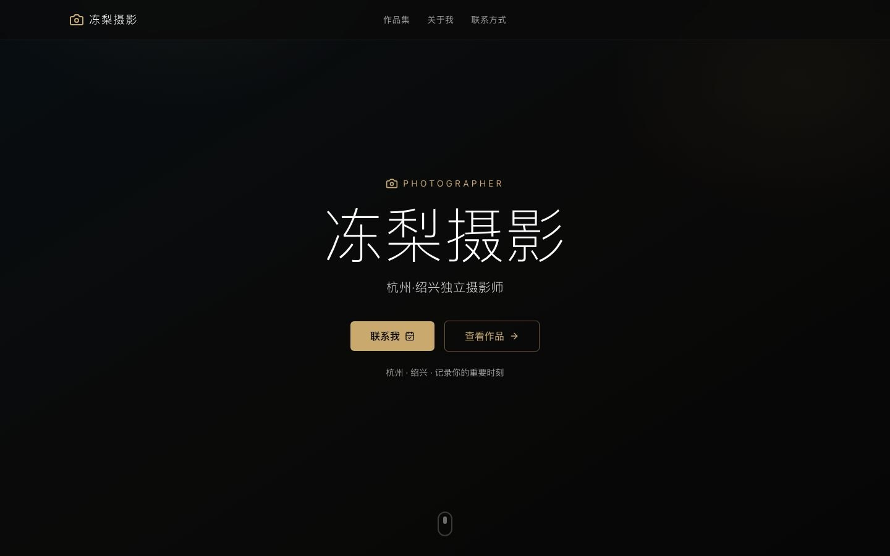
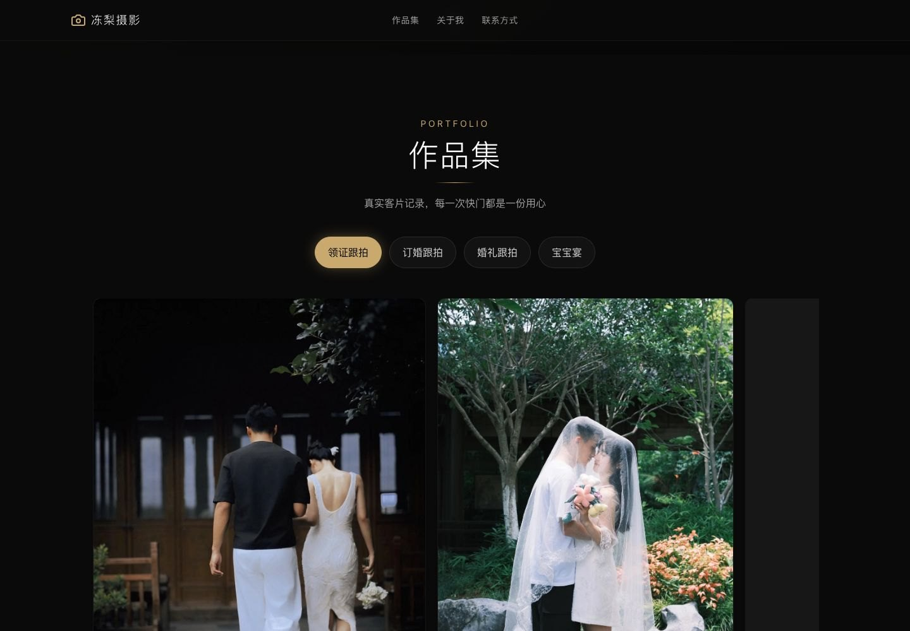
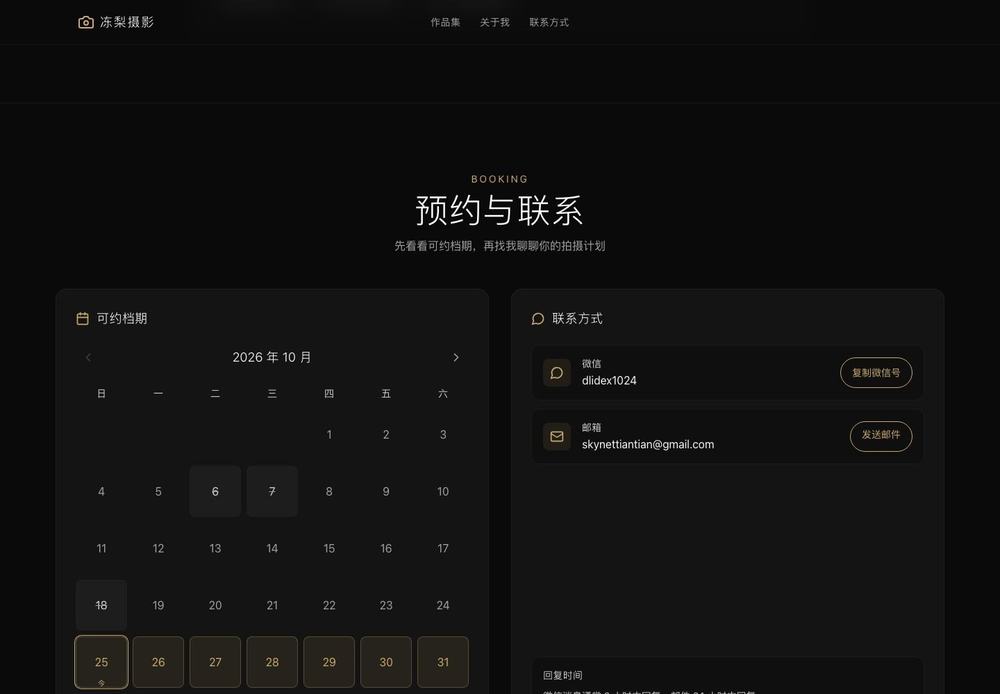
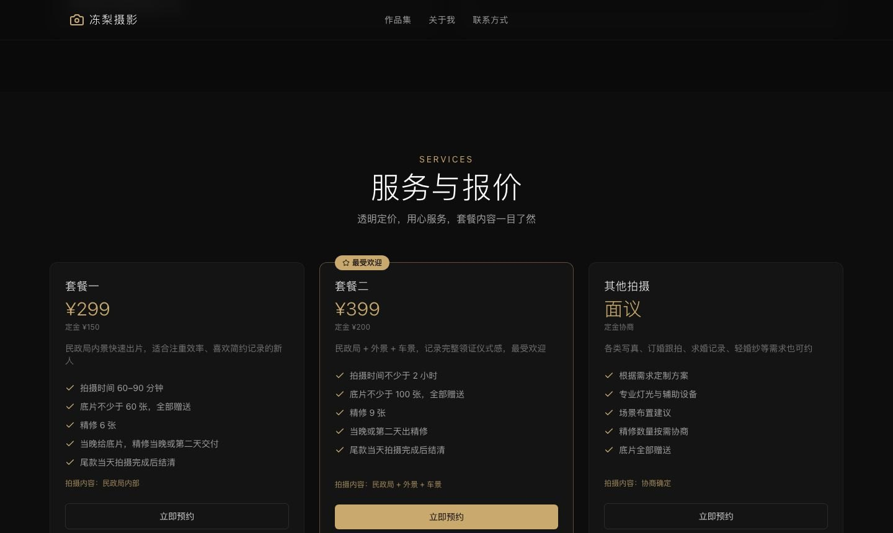
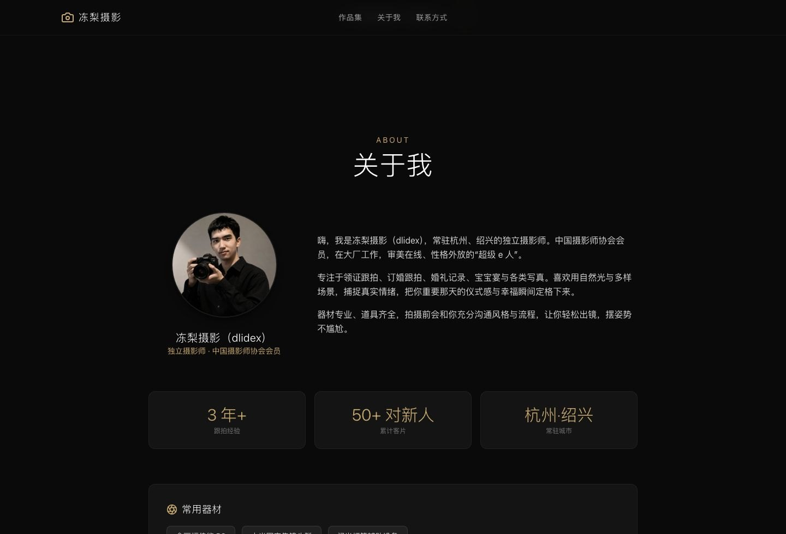
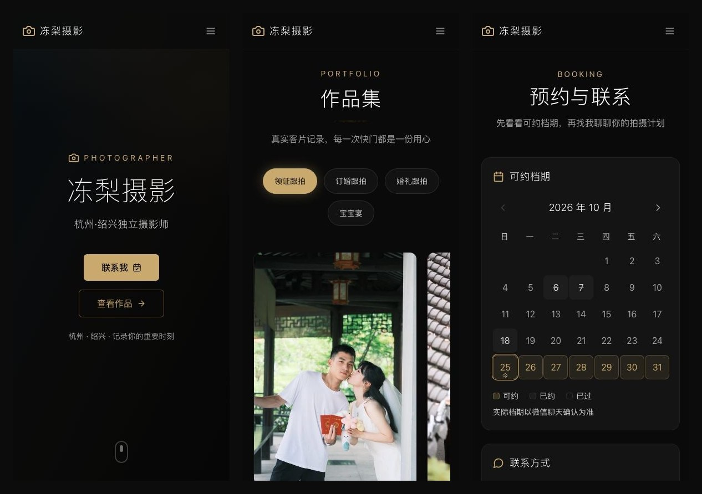
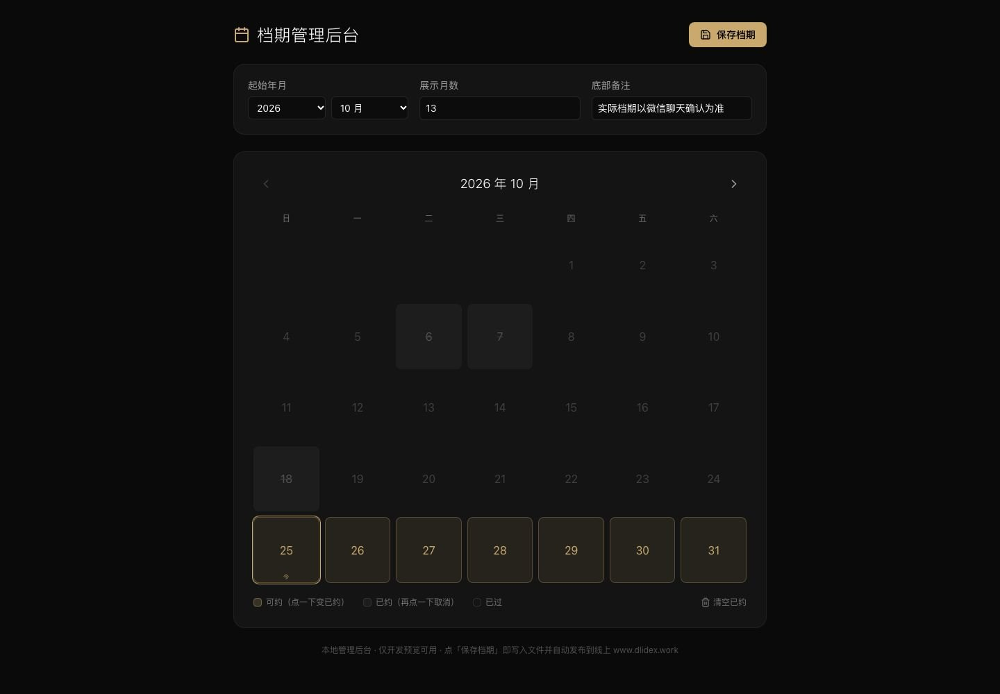
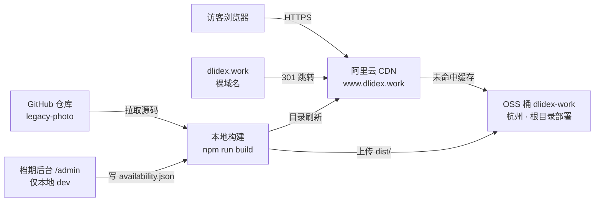

<div align="center">

# 冻梨摄影 · dlidex

**杭州 · 绍兴 独立摄影师个人作品站**

纯前端静态站点 · 移动端优先 · 深色金调视觉

[🌐 线上站点](https://www.dlidex.work) · [📷 作品集](#页面预览) · [🐛 问题反馈](https://github.com/skynet2000/dlidex-photo/issues)


</div>



---

## 目录

- [这个仓库是什么](#这个仓库是什么)
- [页面预览](#页面预览)
- [功能一览](#功能一览)
- [技术栈与部署架构](#技术栈与部署架构)
- [快速开始](#快速开始)
- [项目结构](#项目结构)
- [使用教程](#使用教程)
  - [1. 改文案与联系方式](#1-改文案与联系方式)
  - [2. 上架新客片](#2-上架新客片)
  - [3. 管理可约档期](#3-管理可约档期)
  - [4. 发布上线](#4-发布上线)
- [设计规范](#设计规范)
- [SEO 与性能](#seo-与性能)
- [常见问题](#常见问题)
- [红线清单](#红线清单)
- [版权声明](#版权声明)

---

## 这个仓库是什么

这是一个**真实在运营的摄影师接单站**的完整源码，用于展示客片、公示报价、同步可约档期，让客户在微信沟通之前就能把想知道的都看明白。

| 项目 | 说明 |
|---|---|
| 线上地址 | https://www.dlidex.work |
| 站点类型 | 单页应用（SPA）+ 锚点导航，无后端、无数据库 |
| 内容规模 | 78 张在线客片（另有 20 张写真暂未展示），4 个作品分类 |
| 部署方式 | 静态文件上传至阿里云 OSS，CDN 全球加速（含大陆节点） |
| 备案 | 浙ICP备2026058504号-2 · 浙公网安备33011002020295号 |
| 默认分支 | **`legacy-photo`**（线上真实源码，详见下方说明） |

> **分支说明**：仓库默认分支是 `legacy-photo`，它才是线上运行的版本。仓库里其他分支为历史遗留，不要基于它们发布。

**关于代码与内容**：`src/` 下是可直接复用的前端实现；客片是真实客户照片，仅用于本站展示，版权不随代码开放（见[版权声明](#版权声明)）。

> **客片不随仓库分发**：`public/photos/` 已从 git 历史中移除并加入 `.gitignore`。客户照片可以被批量下载，不适合放在公开仓库里，因此 clone 本项目后作品集区域是空的 —— 把照片放进 `public/photos/` 即可恢复完整效果，页面其余部分（布局、交互、档期、文案）开箱可用。同理，含内部标识的客片同步清单（`sync_manifest*.json`）也不入库。

---

## 页面预览

### 桌面端

| 作品集（分类筛选 + 横向画廊 + 灯箱放大） | 预约与联系（档期日历 + 联系方式） |
|---|---|
|  |  |

| 服务与报价 | 关于我 |
|---|---|
|  |  |

### 移动端

手机访问占比超过八成，全部区块按 390px 宽度逐屏核对过：



### 档期管理后台（仅本地开发环境）



---

## 功能一览

| 模块 | 已实现 |
|---|---|
| **作品集** | 按业务分类筛选（领证 / 订婚 / 婚礼 / 宝宝宴）、横向滑动浏览、左右切换按钮、点击进入灯箱大图并支持缩放 |
| **档期日历** | 从 `availability.json` 实时拉取，标记「可约 / 已约 / 已过」，当前月高亮；加载中、加载失败、重试三种状态齐备 |
| **服务报价** | 三档套餐对比，标注定金、拍摄时长、底片数量、交付时间，一键跳转预约 |
| **联系方式** | 微信号一键复制、邮箱一键唤起邮件客户端、回复时效说明 |
| **响应式** | 移动端汉堡菜单、竖向堆叠；平板与桌面并排布局；横屏手机单独适配 |
| **无障碍** | 语义化标签、按钮 `aria-label`、`aria-controls`、键盘可操作、焦点可见描边、`prefers-reduced-motion` 降级 |
| **SEO** | 独立 `title` / `description` / Open Graph / Twitter Card / `canonical` / `robots.txt` / `sitemap.xml` |
| **数据兜底** | 档期 JSON 格式非法时拒绝渲染为"可约"，改为提示联系确认，避免误导客户 |

---

## 技术栈与部署架构

| 层 | 选型 |
|---|---|
| 构建 | Vite 7 |
| 框架 | React 19 + TypeScript（strict） |
| 样式 | Tailwind CSS v4（`@tailwindcss/vite`） |
| 图标 | lucide-react |
| 灯箱 | yet-another-react-lightbox（Zoom 插件） |
| 托管 | 阿里云 OSS（杭州）+ CDN（全球加速） |
| 证书 | DigiCert 个人测试证书（免费 DV） |



**为什么是"静态站 + 对象存储"**：全站没有需要登录的用户数据，页面几百 KB，静态托管可以做到零运维、零服务器费用、抗住突增访问；档期数据用一个 JSON 文件承载，改完刷缓存即生效。

---

## 快速开始

### 环境要求

- Node.js **20+**（推荐 22 LTS）
- npm 10+

### 本地运行

```bash
git clone https://github.com/skynet2000/dlidex-photo.git
cd dlidex-photo
git checkout legacy-photo      # 必须切到线上分支

npm install
npm run dev                    # http://localhost:5173
```

### 构建与预览

```bash
npm run build      # 类型检查 + 打包，产物在 dist/
npm run preview    # 本地预览生产包
```

构建产物说明：

| 文件 | 用途 |
|---|---|
| `dist/index.html` | 入口（体积约 2 KB，其余走 hash 资源） |
| `dist/assets/index-[hash].js` | React 运行时 + 业务代码 |
| `dist/assets/*.css` | Tailwind 编译结果 |
| `dist/photos/*.webp` | 客片原图（不会被 hash，文件名稳定利于缓存） |
| `dist/availability.json` | 档期数据 |

---

## 项目结构

```
.
├── src/
│   ├── data.ts                  ★ 全站内容源：文案、分类、客片、套餐、联系方式
│   ├── App.tsx                  页面骨架（区块顺序与锚点）
│   ├── main.tsx                 入口；仅 dev 下挂载 /admin 后台
│   ├── components/
│   │   ├── Navbar.tsx           顶部导航（移动端汉堡菜单）
│   │   ├── Hero.tsx             首屏（渐变 + 金调光晕）
│   │   ├── Portfolio.tsx        作品集（筛选 / 横滑 / 灯箱）
│   │   ├── About.tsx            关于我 + 器材
│   │   ├── Availability.tsx     档期日历
│   │   ├── Services.tsx         服务与报价
│   │   ├── Contact.tsx          联系方式
│   │   └── Footer.tsx           页脚
│   ├── admin/
│   │   └── AvailabilityEditor.tsx   档期后台（生产构建时被剔除）
│   └── lib/                     工具函数
├── public/
│   ├── photos/*.webp            客片（WebP q82，长边 ≤1600，已去 EXIF）※不入库，本地自备
│   ├── availability.json        档期数据（线上为真实客户数据）
│   ├── robots.txt
│   ├── sitemap.xml
│   └── favicon.svg
├── scripts/                     客片同步、证书换新等运维脚本
├── docs/images/                 README 配图
└── vite.config.ts               含 dev 期档期读写接口 + 后台代码剔除插件
```

**核心约定**：内容全部集中在 `src/data.ts`，组件只负责渲染。改文案、加照片、调价格都只动这一个文件。

---

## 使用教程

### 1. 改文案与联系方式

打开 `src/data.ts`，文件顶部就是站点信息：

```ts
export const siteConfig = {
  name: "冻梨摄影",
  tagline: "杭州·绍兴独立摄影师",
  description: "……",           // 同时用于 <meta name="description">
  contact: {
    wechat: "dlidex1024",
    email: "skynettiantian@gmail.com",
    phone: "",
  },
};
```

> 改完记得同步 `index.html` 里的 `<title>`、`og:title`、`og:description`——那是分享到微信/X 时展示的文案，不随 `data.ts` 变化。

### 2. 上架新客片

一次完整的上新分三步：**放文件 → 写数据 → 发布**。

**第一步：处理图片**

```bash
# 需要 webp 工具：macOS 执行 brew install webp
# 统一压成 WebP，长边不超过 1600，质量 82，并去掉 EXIF（含拍摄地点等隐私）
cwebp -q 82 -resize 1600 0 原图.jpg -o public/photos/c-1a2b3c4d5e.webp
```

> 不想装命令行工具，也可以用 Squoosh（网页版）导出 WebP，参数选质量 82、长边 1600、勾选"移除元数据"。

文件命名规则（id 即文件名主体）：

| 前缀 | 业务类型 | 示例 |
|---|---|---|
| `c-` | 领证跟拍 | `c-1a2b3c4d5e.webp` |
| `d-` | 订婚跟拍 | `d-9f8e7d6c5b.webp` |
| `w-` | 婚礼跟拍 | `w-3c4d5e6f7a.webp` |
| `b-` | 宝宝宴 | `b-7a8b9c0d1e.webp` |
| `x-` | 各类写真（当前隐藏） | `x-5e6f7a8b9c.webp` |

**第二步：写进 `data.ts`**

```ts
export const portfolioItems: PortfolioItem[] = [
  {
    id: "c-1a2b3c4d5e",                  // = 文件名（不含扩展名）
    title: "领证跟拍 · c-1a2b3c4d5e",     // 灯箱标题
    category: "领证跟拍",                 // 必须是 portfolioCategories 里的 id
    album: "5",                          // 可选：二级分组（如"第 5 场"）
    src: "photos/c-1a2b3c4d5e.webp",      // 相对路径，不要写域名
    width: 1067,                          // 压缩后的真实宽高，用于占位避免跳动
    height: 1600,
  },
];
```

**第三步：发布**（见 [4. 发布上线](#4-发布上线)）

> 也可以走自动化：仓库外的「客片同步」脚本会从 IMA 知识库拉原图、去重、压缩、重建 `portfolioItems`，再一键部署。手动改这一段会在下次同步时被覆盖。

### 3. 管理可约档期

档期后台**只在本地开发环境存在**（`import.meta.env.DEV` 判断 + 构建期插件剔除），生产包里没有任何后台代码，不用担心被外人打开。

```bash
npm run dev
# 浏览器打开 http://localhost:5173/admin
```

操作流程：

1. 点日历上任意日期 → 在「可约 / 已约」之间切换
2. 顶部可调整起始年月、展示月数、底部备注
3. 点右上角 **保存档期** → 写入 `public/availability.json` → **自动执行构建 + 上传 + 刷 CDN**

> ⚠️ 线上档期是真实客户预约，本地测试保存前请先备份 `public/availability.json`。发布流程里也会强制先从线上拉取这份文件。

### 4. 发布上线

发布是把 `dist/` 推到 OSS 再刷 CDN，一共四步，顺序不能乱：

```bash
# 0）【必做】先把线上真实档期拉回本地，否则会用旧数据覆盖掉客户预约
curl -s https://www.dlidex.work/availability.json -o public/availability.json

# 1）构建
npm run build

# 2）上传 OSS（根目录部署，--no-cleanup 保证旧 hash 资源不被删）
python3 <deploy-oss.py> --bucket dlidex-work --region oss-cn-hangzhou \
  --prefix "" --dist dist --no-cleanup

# 3）刷新 CDN（必须 Directory 类型，File 级刷不全）
python3 <refresh-cdn.py> --domain www.dlidex.work --type Directory --paths /

# 4）【易漏】重设首页缓存头：上传会覆盖 OSS 元数据
#    index.html 需要 public, max-age=60，否则 CDN 不缓存 HTML，每次都回源
```

验收（绕过 CDN 查源站，再查边缘）：

```bash
curl -s https://dlidex-work.oss-cn-hangzhou.aliyuncs.com/index.html | grep -o 'assets/index-[^"]*\.js'
curl -s https://www.dlidex.work/ | grep -o 'assets/index-[^"]*\.js'
```

> `deploy-oss.py` / `refresh-cdn.py` 是同机另一仓库的工具脚本，凭据放在仓库外的本地文件里，**不入库**。

---

## 设计规范

| 项 | 取值 |
|---|---|
| 主色 | `#c9a96e`（香槟金），高亮态 `#dfc499` |
| 背景 | `#0a0a0a` 主背景 / `#0f0f0f` 卡片 |
| 正文色 | `neutral-300`（次要 `neutral-400`） |
| 圆角 | 卡片 `rounded-xl`，按钮 `rounded-md` / `rounded-full` |
| 触控尺寸 | 所有可点元素 ≥ 44×44px |
| 字号 | 首屏标题 `text-5xl ~ text-8xl`，正文 `text-base`，辅助 `text-sm` |
| 动效 | 淡入上移、5 秒渐变轮换；`prefers-reduced-motion` 时全部关闭 |

深色视觉是刻意的：客片以暗调、暖调为主，深底能让照片更突出，金色作为点缀暗示"婚礼 / 纪念日"。

---

## SEO 与性能

- 每张客片写入真实 `width` / `height`，避免图片加载时布局跳动（CLS）
- 首页 HTML 约 2 KB，主 JS 约 195 KB（gzip 后 ~61 KB），CSS 约 37 KB（gzip 后 ~7 KB）
- 客片统一 WebP，比原 JPG 平均小 60% 以上
- CDN 缓存策略：`assets/*` 走 hash 长缓存，`index.html` 缓存 60 秒，`availability.json` 每次校验
- 已配置 `robots.txt`、`sitemap.xml`、`canonical`；裸域名 301 到 `www`，避免重复收录

> 说明：站内导航全部是锚点（`#about` 这类），因此 `/about` 直接访问会 404，这是预期行为。刻意**不**把 404 兜底成首页——否则图片真丢失时也会返回 200，问题会被掩盖。

---

## 常见问题

<details>
<summary><b>改了文案，线上没变化？</b></summary>

`index.html` 有 60 秒缓存。要么等一分钟，要么强刷（`Cmd/Ctrl + Shift + R`）。如果超过 5 分钟还没变，检查 CDN 是否真的刷新成功。
</details>

<details>
<summary><b>本地开发时图片打不开？</b></summary>

确认图片放在 `public/photos/` 下，且 `data.ts` 里 `src` 写的是相对路径 `photos/xxx.webp`（不要带前导 `/`，也不要写完整域名）。
</details>

<details>
<summary><b>归档文字被压到第二行了 / 排版怪？</b></summary>

先确认手机宽度是否符合预期。Chrome headless 截图有 500px 最小窗口限制，测真机效果要用真机或 DevTools 设备模拟。
</details>

<details>
<summary><b>为什么生产包里搜不到后台代码？</b></summary>

`vite.config.ts` 里的 `stripAdminInProd` 插件会在构建时删除 `main.tsx` 中的后台动态导入，确保 `AvailabilityEditor` 不进生产包。（Rollup 对死分支里的动态 import 仍会产出 chunk，所以必须显式剔除。）
</details>

<details>
<summary><b>可以直接把整个站迁到 Cloudflare 吗？</b></summary>

不建议。本站 CDN 加速区域是 `global`（含中国大陆节点）且有 ICP 备案；整站切到境外节点会触发备案注销，同时大陆访问明显变慢。可行做法只是把 DNS 托管过去（灰云），保留原有 CDN。
</details>

---

## 红线清单

| 红线 | 后果 |
|---|---|
| 🔴 上传前没拉线上 `availability.json` | 真实客户预约日期被本地旧文件覆盖，**直接丢单** |
| 🔴 用 `--delete` / 整桶清空方式上传 | 旧 hash 的 JS/CSS 被删，已打开页面的用户白屏 |
| 🔴 刷 CDN 只用 File 类型 | 部分节点刷不到，出现新旧版本混搭 |
| 🔴 把 AK/SK 写进代码或 `.env` 提交 | 密钥泄漏，OSS/CDN 可能被刷爆（`.gitignore` 已排除 `.env`，请勿强制添加） |
| 🔴 整站迁 Cloudflare 橙云 | 触发备案注销 + 大陆访问变慢 |

---

## 版权声明

- **代码**：本仓库前端实现仅供学习参考，未采用开源许可，保留所有权利。
- **客片与文案**：`public/photos/` 中的所有照片为真实客户委托拍摄作品，版权归客户与摄影师所有。**禁止下载、转载、二次使用或用于任何商业目的。**
- **品牌**：站点名称、标识归站点所有者所有。

如需引用代码片段，请注明出处；如需使用照片，请先取得书面授权。

---

<div align="center">

**冻梨摄影** · 杭州 · 绍兴 · 记录你的重要时刻

[www.dlidex.work](https://www.dlidex.work)

</div>
